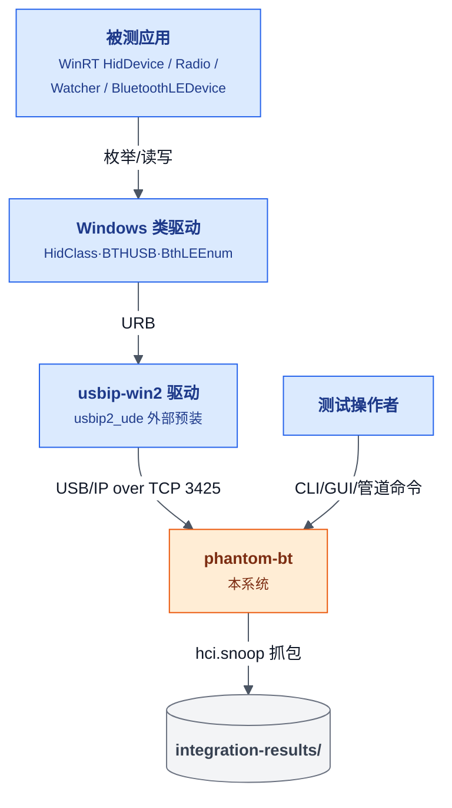
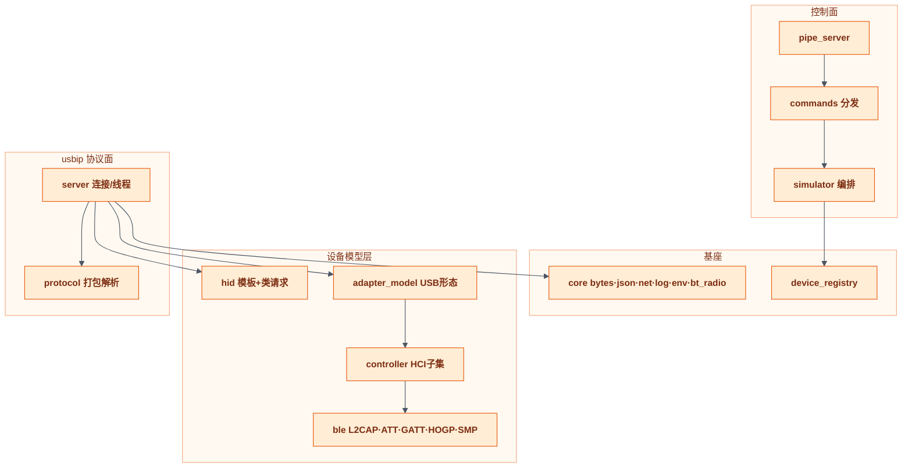
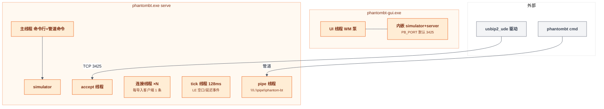
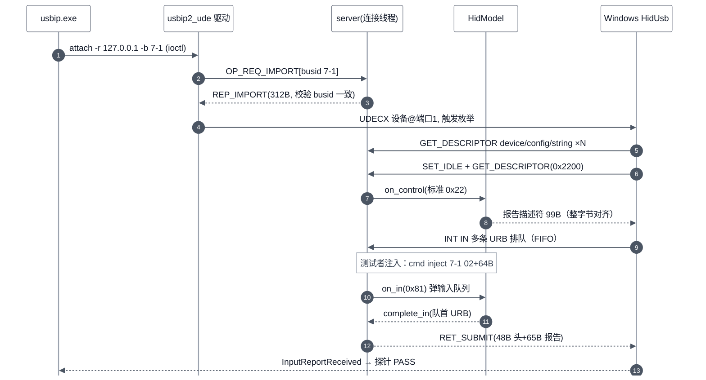
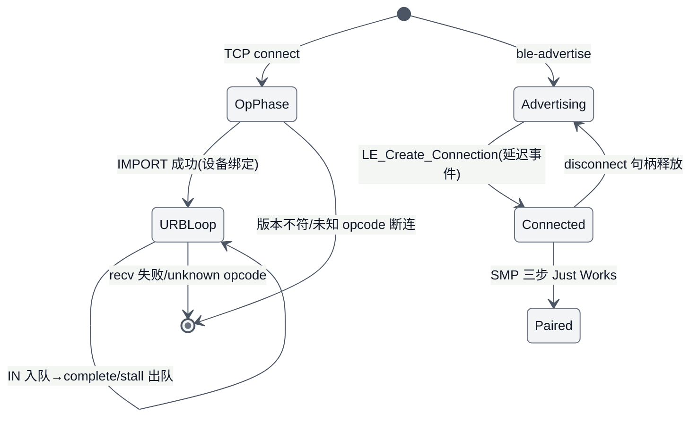
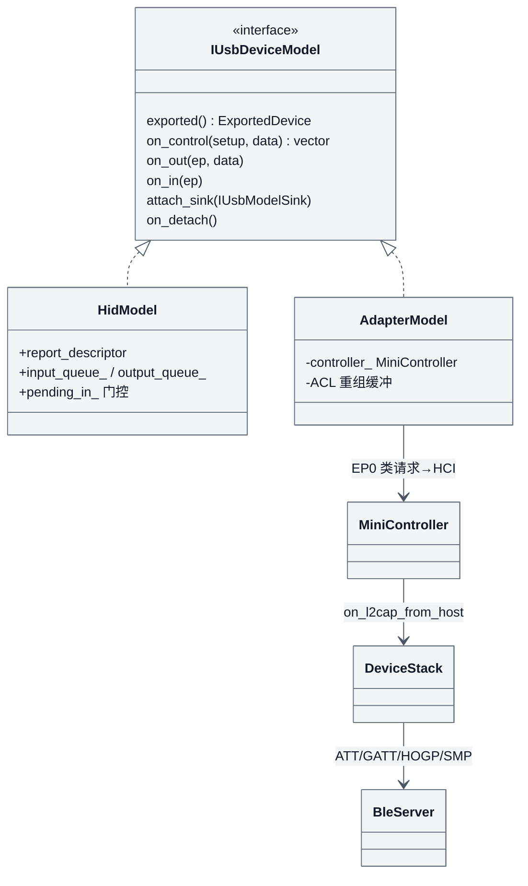

# Phantom-BT 详细设计

> 类型：arch ｜ 模式：Reverse ｜ 代码基线：`a6a8d1b`（工作区 77 个未提交变更） ｜ 最后核对：2026-11-01 ｜ 范围：`src/`、`tools/`、`tests/` ｜ lang: zh

## Overview

Phantom-BT 是 Windows 单机纯软件测试台：`src/` 约 3.4k 覆盖行、**343 个单测（96%+ 行覆盖）**，通过 usbip-win2 驱动把仿真 USB HID / 蓝牙适配器 / BLE HID 设备呈现给 WinRT API。真机验收：M0 PASS、M1 PASS(registry)；M2/M3 阻塞于 Windows 蓝牙栈接管（见 R-001）。

**TL;DR**

- usbip 线协议已切换为真实方言（op_common 8B 头 + 48B 帧头），与 usbip-win2 0.9.8 真机客户端互操作
- 每端点挂起 IN URB 为 FIFO 队列，HID 报告描述符强制整字节对齐——这两点是 M0 真机 PASS 的前提
- 端口策略：本仓默认 **3425**，3240 让给同机 phantom-audio 项目的 uacsimd
- 全流程一键门禁 `tools/run-all.ps1`：10 阶段 450s，含 M0/M1 真机

图例：蓝=外部方，橙=本系统，灰=存储/外部依赖。

## Architecture Context

## Logical Architecture

## Component Responsibilities

| Component | 负责 | 不负责 |
|---|---|---|
| `control/commands` | 17 条命令分发、参数个数校验、错误转文案 | 设备语义（全数委托 simulator） |
| `sim/simulator` | 设备装载/卸载编排、tick 线程、BLE 广播编排、attach（busid 白名单+`-t` 端口）、detach（busid→port 映射后 `-p`） | usbip 线协议解析 |
| `usbip/server` | TCP 监听、每连接线程、op 阶段分发、URB 循环、**每端点挂起 IN FIFO 队列**、RET 组包 | 描述符与类请求语义 |
| `usbip/protocol` | 真实方言常量（`OP_VERSION=0x0111` 等）、`usbip_usb_device` 312B 布局、48B 帧打包/解析 | 任何 I/O |
| `usb/descriptors`+`usb/control` | 标准请求（device/config/string/qualifier 拒绝）、描述符构造、IAD | 类请求（0x22/GET_REPORT 归模型） |
| `hid/*` | 四模板报告描述符（整字节对齐）、类请求、输入/输出报告队列 | 传输与端点 |
| `bluetooth/adapter_model` | 适配器 USB 形态（E0/IAD）、EP0 类请求→HCI 路由、ACL 分片重组 | HCI 命令语义 |
| `hci/controller` | HCI 命令子集、事件构造、`delayed_events`、连接状态机、NoCP 流控 | USB 传输 |
| `ble/*` | L2CAP 固定通道、ATT/GATT 数据库、HOGP、SMP Just Works、AES/CMAC | HCI 命令解析 |
| `core/*` | 字节读写、JSON、TCP、日志、环境体检、物理电台 SetupAPI、GUI test_runner | 业务语义 |
| `probes/winrt-probe` | hid/radio/watcher/ble 四探针（设备发现带重试） | 仿真 |

## Runtime / Deployment Architecture

## Key Data Flow / Sequence

M0 真机链路（2026-11-01 实测 trace 还原；步骤表 # 对应图中 autonumber 编号）：

| # | 参与方 | 动作 | 源码 |
|---|---|---|---|
| 1 | CLI | `usbip -t 3425 attach -r 127.0.0.1 -b 7-1`（busid 白名单校验） | `src/sim/simulator.cpp:313-340` |
| 2 | server | op_common 8B 头校验版本 0x0111，import 查注册表 | `src/usbip/server.cpp:148-193` |
| 3 | protocol | REP_IMPORT 应答 312B 设备结构，驱动校验 busid 一致 | `src/usbip/protocol.cpp:61-68` |
| 4 | 驱动 | UDECX 创建设备节点并触发 Windows 枚举 | usbip-win2 `vhci_ioctl.cpp:181-230` |
| 5 | 控制层 | 标准描述符请求（device 18B/config 41B/string）走 `descriptor_request` | `src/usb/control.cpp:17-33` |
| 6 | HidModel | SET_IDLE（类请求）+ GET_DESCRIPTOR(0x2200) 到达 | `src/hid/hid_model.cpp:92-100` |
| 7 | HidModel | 标准 0x22 接口接收者路径，应答 99B（整字节对齐） | `src/hid/hid_model.cpp:81-90` |
| 8 | server | 挂起 IN 入队 `pending_ins[ep].push_back`（每端点 FIFO） | `src/usbip/server.cpp:305-311` |
| 9 | simulator | `cmd inject 7-1 02+64B` 入输入队列 | `src/hid/hid_model.cpp:144-151` |
| 10 | server | `on_in(0x81)` 弹队首报告（锁外调用防死锁） | `src/hid/hid_model.cpp:131-142` |
| 11 | ConnSink | 队首 URB 完成+出队，RET 组包 | `src/usbip/server.cpp:355-370` |
| 12 | 驱动 | `assign()` 校验 actual≤请求长，短读合法 | usbip-win2 `wsk_receive.h:40` |
| 13 | 探针 | HidDevice.InputReportReceived 触发，输出 PASS | `src/probes/main.cpp:108-125` |

## Interface / Contract

控制面 17 条命令（CLI `cmd`/GUI/管道同语法）：`load-hid <json>`、`load-bt`、`unload <busid>`、`unload-all`、`list`、`attach <busid>`、`detach <busid>`、`inject <busid> <hex>`、`ble-advertise <json>`、`ble-stop <addr>`、`ble-clear`、`ble-list`、`ble-type <addr> <text>`、`sys-bt <list|disable|enable>`、`snoop <path>|off`、`status`、`help`。应答为行帧，`OK-END` 结尾；错误以 `ERR` 开头。

usbip 线格式（全部大端）：

| 帧 | 布局 | 关键值 |
|---|---|---|
| op_common (8B) | `u16 ver + u16 code + u32 status` | ver=0x0111；REQ_DEVLIST=0x8005、REQ_IMPORT=0x8003、REP_IMPORT=0x0003 |
| REQ_IMPORT 体 | `busid[32]` | 应答=312B `usbip_usb_device`（path[256]+busid[32]+busnum/devnum/speed+vid/pid/bcd+7B 类配置） |
| CMD_SUBMIT (48B) | 基本头 20B（op/seq/devid/dir/ep）+flags+len/start/npkts/interval+setup[8] | ep 为 0–15 端点号，服务器 `ep\|0x80` 转地址 |
| RET_SUBMIT (48B) | 同上布局，actual 在偏移 24 | IN 方向在头后附 data |
| CMD_UNLINK | 基本头 20B + unlink_seqnum 4B | 扫描各端点 FIFO 匹配 |

speed 字段为内核方言 `USBIP_SPEED_FULL=2`。

## State / Lifecycle

## Data Model

## Non-Functional Requirements

| Category | Requirement |
|---|---|
| 时效 | run-all 全流程 450s（单测 59s、覆盖率 31s、M0 真机 63s，2026-11-01 实测） |
| 并发 | 每连接 1 线程 + tick 线程；锁序 model.mx→ctx.mx 单向，on_in 在 ctx.mx 锁外调用 |
| 端口 | serve/脚本默认 3425（`PB_PORT` 可覆盖）；3240 保留给同机 uacsimd，绝不互杀 |
| 确定性 | 测试禁 sleep/时序假设，用事件标志（atomic）+ `cov_spin_until` |
| 覆盖率 | src/** 行覆盖 96%+（排除 gui/probes/cli），OpenCppCoverage 退出码 0/3 均为测量完成 |

## Key Decisions

| ID | Decision | Status | Alternatives | Reason | Impact |
|---|---|---|---|---|---|
| ADR-001 | usbip 线协议采用真实方言（op_common+48B 帧） | Accepted | 保持私有协议 | 真实 usbip.exe 首包即可互通 | 回环测试全部改写为方言 |
| ADR-002 | 每端点挂起 IN 为 FIFO 队列 | Accepted | 单槽覆盖 | HidUsb 启动即排队多条中断读，单槽丢 URB 致 code 10 | UNLINK 需扫全队列 |
| ADR-003 | HID 报告描述符整字节对齐（hat 4b+4b Const） | Accepted | 非 aligned 位字段 | 非 aligned 总长触发 HidUsp 启动失败（真机 code 10 实证） | 模板需对齐审查 |
| ADR-004 | HS 中断端点 interval=4（微帧语义） | Accepted | interval=1 | UDE 模拟 HS 总线，1 在微帧语义非法 | 等效 1ms 轮询 |
| ADR-005 | 端口默认 3425 双项目共存 | Accepted | 抢占 3240 | 同机 phantom-audio 常驻 uacsimd | 全部脚本/CLI/GUI 参数化 |
| ADR-006 | 覆盖率门禁容忍 OpenCppCoverage 退出码 3 | Accepted | 视为失败 | Debug CRT 堆校验与插桩退出期偶发断言，报告仍完整 | CI 先设 `_NO_DEBUG_HEAP=1` |

## Risks / Open Issues

| ID | Issue / Risk | Impact | Status | Owner |
|---|---|---|---|---|
| R-001 | Windows 蓝牙栈不对虚拟适配器下发 HCI（hci.snoop 零记录），M2/M3 阻塞 | High | Open · 阻塞真机 ②③④ | 维护者 |
| R-002 | SMP c1 布局存在两组互相矛盾的外部复核（Zephyr/Linux vs 规范+crackle） | Medium | Open · 待真机配对裁决 | 维护者 |
| R-003 | 监听绑 `INADDR_ANY`，协议解析面暴露到局域网 | Medium | Open | 维护者 |
| R-004 | check-tools 存在 7 行按设计标红的已知缺陷用例 | Low | Open · 详见 full-test-report | 维护者 |
| R-005 | usbip Server::stop() 与连接线程的 UAF 已确认（评审 high） | High | Open | 维护者 |

## 待确认项

- [ ] 工作流 16 项缺陷积压中 `stop-uaf`、`resize-clamp`、`double-import` 等的最终落地状态需对照 `docs/global-review-2026-11-01.md` 与工作区 diff 核对
- [ ] `wusbip.exe`（usbip-win2 GUI 客户端）与本服务器的兼容性未测
- [ ] SMP c1 布局以 BT SIG 官方向量一锤定音（依赖 R-001 解锁）
