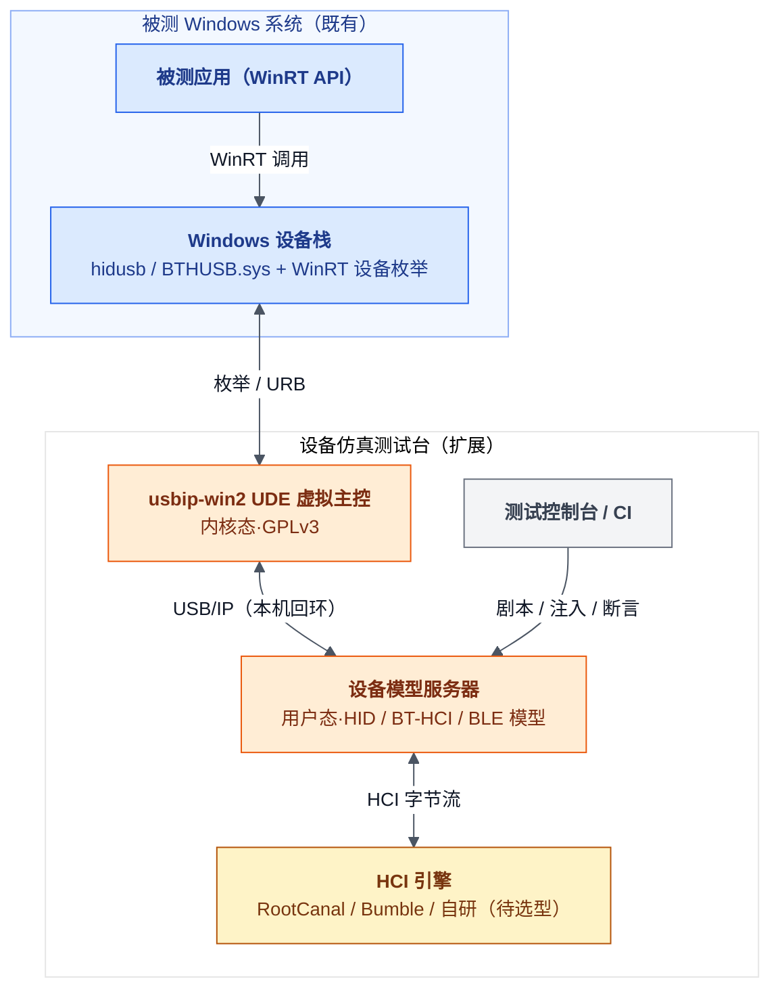
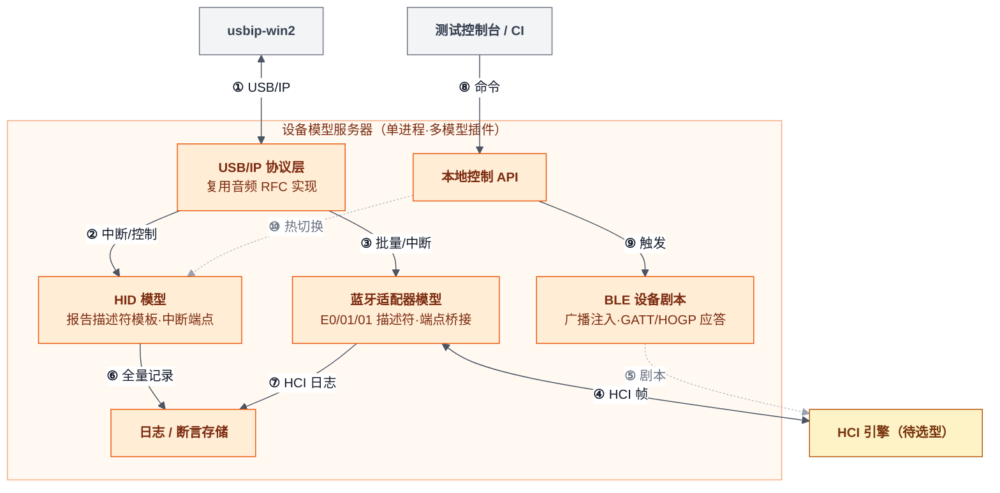
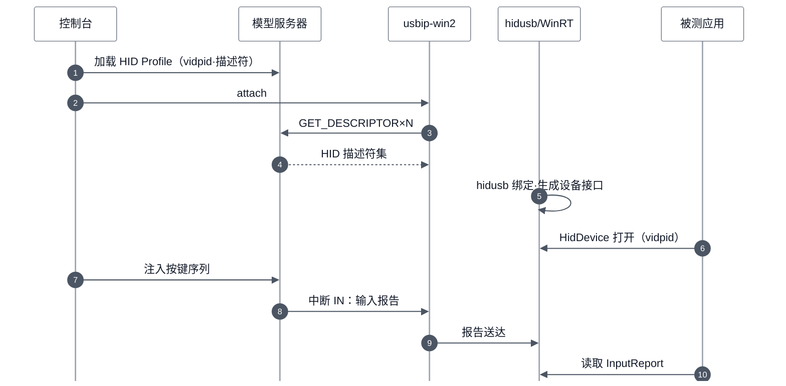
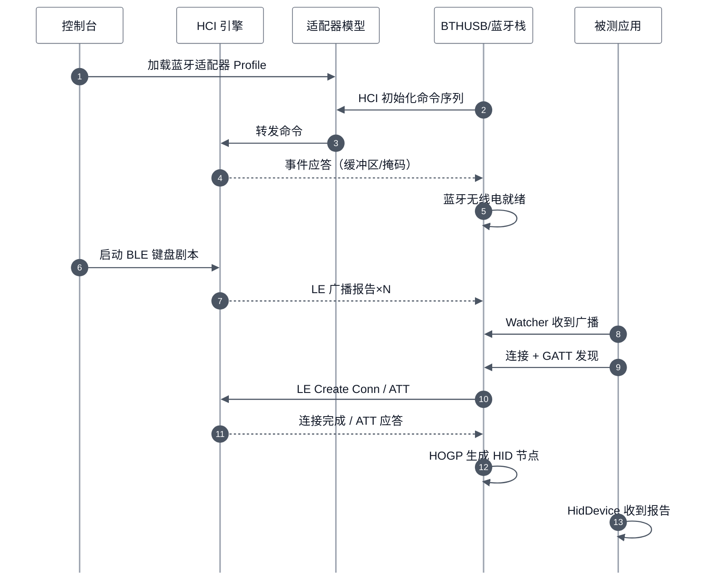

# RFC: Windows 虚拟 USB 蓝牙适配器与 HID / BLE HID 仿真（WinRT 可见）

> 类型：rfc ｜ 模式：Forward ｜ 状态：Draft ｜ 代码基线：`none` ｜ 最后核对：2026-10-29 ｜ 范围：`tools/phantom-audio/`（扩展，暂名） ｜ lang: zh
>
> **需要你**：评审人（驱动组 + 测试组）在 2026-11-05 前确认 HCI 引擎选型路线（复用 RootCanal/Bumble 还是自研精简子集），以及与音频 RFC 的合并排期

## Summary

扩展 [rfc-windows-virtual-uac-device.md](rfc-windows-virtual-uac-device.md) 测试台：新增**USB HID**、**USB 蓝牙适配器**（Class E0/01/01，BTHUSB.sys 绑定）与 **BLE 设备（含 HID over GATT）**三类模型。

三类设备只走控制/批量/中断端点，**不涉及等时传输**，规避音频方案的最大风险 R-001。验收口径：被测 WinRT API（`Windows.Devices.HumanInterfaceDevice` / `Windows.Devices.Bluetooth`）可见、可打开、可收发数据。

**TL;DR**

- 端点类型利好：HID 用中断端点、蓝牙 HCI 用批量+中断端点；旧版 usbip-win 时代中断/批量即受支持，UDE 文档亦覆盖，风险远低于音频的等时链路。
- 蓝牙路线的关键分层：虚拟的是 **USB 蓝牙适配器（USB Class E0/01/01）**，Windows 内置 BTHUSB.sys 自动绑定；BLE"设备"在 HCI 层合成（广播注入、连接、GATT/HOGP 应答）。
- HCI 引擎优先复用：RootCanal（AOSP 蓝牙控制器仿真器）与 Bumble（谷歌 Python 蓝牙栈）均为 Apache-2.0，许可干净，且久经 CI 考验。
- WinRT 可见性是自动结果而非额外工作：WinRT HID/BLE API 架在内置 hidusb 与 BTHUSB 栈之上，类驱动绑定成功即对 WinRT 透出。
- USB HID 是最低风险起点（M0 探针），蓝牙链路是独立里程碑，可分级交付。

## Motivation

测试主机侧软件对标准 USB / 蓝牙外设的兼容性，依赖真实硬件。痛点有四：型号标识固定、事件难以复现、异常场景缺失、台架成本高。本轮新增两类测试对象的痛点：

1. **HID 外设**（键盘/鼠标/游戏手柄/自定义控制器）：按键序列、报告描述符变体、异常报告需要可编程注入。
2. **蓝牙 / BLE HID**：真实 BLE 外设的广播内容、GATT 服务形态、配对行为难以脚本化回归；被测应用使用 WinRT `Windows.Devices.Bluetooth` / `HidDevice` API，测试要求虚拟设备必须出现在同一 API 视图里。

需求方明确要求：纯软件、Windows 单机、可指定 VID/PID、**通过 WinRT API 可见可用**。

## Goals / Non-Goals

| Goals | Non-Goals |
|---|---|
| R1 纯软件单机，延续音频 RFC 的测试台架构 | 不做 BR/EDR 语音 SCO 链路（需等时端点，主动规避） |
| R2 USB HID：可配报告描述符与 VID/PID，中断输入/输出报告 | 不做真实射频/空中接口仿真（仅在 HCI 及以上合成） |
| R3 虚拟 USB 蓝牙适配器：BTHUSB.sys 按类绑定（E0/01/01） | 不覆盖 Win10 1903 之前系统（usbip-win2 下限） |
| R4 BLE 设备：广播注入、连接、GATT 服务、HID over GATT | 不做 UVC 视频（另行立项） |
| R5 WinRT 验收：`HidDevice` 可打开收发；`BluetoothLEAdvertisementWatcher` 可见广播；`BluetoothLEDevice` 可连可发现服务 | 不实现完整 HCI 命令面，仅覆盖 Windows 栈初始化与测试场景所需子集 |
| R6 延续：事件/异常注入、控制与数据全量日志、Profile 热切换 | — |

## Proposed Design

图例：颜色仅标系统边界；实线为主数据路径，虚线为配置/剧本路径。全部组件运行在同一台被测 Windows 机器上。

分层是本设计的核心决策：仿真器对 USB 层只暴露**一个蓝牙适配器 + 若干 HID 设备**；BLE"外设"不出现在 USB 层，而由 HCI 引擎在控制器层合成。

需求到组件的映射：

| 需求 | 承接组件 / 机制 |
|---|---|
| R1 纯软件单机 | UDE 虚拟主控 + 本机回环 USB/IP，无物理设备 |
| R2 USB HID | HID 模型：Profile 定义报告描述符与 VID/PID；中断 IN/OUT 端点 |
| R3 虚拟蓝牙适配器 | 蓝牙适配器模型：USB Class E0/01/01 描述符，事件走中断 IN、ACL 走批量端点；BTHUSB.sys 类驱动自动绑定 |
| R4 BLE 设备 | HCI 引擎合成：LE 广播报告事件、LE 连接、ATT/GATT 应答（含 HID Service）；BLE 剧本可编程 |
| R5 WinRT 验收 | 类驱动绑定成功即完成：hidusb 生成 HID 设备接口供 `HidDevice` 打开；BTHUSB 栈把 BLE 设备透出给 `BluetoothLEAdvertisementWatcher` / `BluetoothLEDevice` |
| R6 注入与观测 | 控制 API 触发按键序列 / 广播 / 配对剧本；HID 报告与 HCI 帧全量落日志 |

两个设计要点：

- **不声明 SCO 等时端点**：蓝牙 USB 传输规范中 SCO 语音为可选端点集，省略后 HFP 语音类测试不可用（已列入 Non-Goals），换来彻底规避等时链路风险。
- **VID/PID 双重用途**：WinRT `HidDevice` 要求 UWP 应用在清单声明 `humaninterfacedevice` 设备能力并按 `vidpid` 匹配；仿真器可配 VID/PID 让被测应用的清单声明可预先固定。

## Key Flows

### USB HID：从枚举到 WinRT 收到输入报告

主路径为顺序第 1-11 步；中断端点轮询由 usbip-win2 持续发起。

### BLE HID 键盘：广播、连接到 GATT 服务暴露

第 1-6 步验证适配器与 HCI 引擎；第 7-13 步验证 BLE HID 全链路直至 WinRT 双视图（蓝牙设备 + HID 设备）。

## Alternatives Considered

| Alternative | Why not chosen |
|---|---|
| Linux BlueZ `/dev/vhci` + `btvirt`（内核虚拟控制器） | 仅能被 Linux 内核绑定，测 Linux 主机栈；无法向 Windows 提供 USB 蓝牙适配器；保留作 Linux 侧对照测试 |
| QEMU `bt-vhci` / Cuttlefish 整机虚拟化 | 面向 Linux/Android guest 的虚拟机方案，被测对象是 Windows 物理机上的 WinRT 应用；RootCanal 以组件方式复用而非整机 |
| 自研完整 HCI 引擎 | HCI 命令面庞大；仅实现 Windows 初始化与测试子集可行，但复用 RootCanal/Bumble（Apache-2.0）可省大部分协议实现 |
| 纯 WinRT 层桩（mock `HidDevice`/`BluetoothLEDevice`） | 绕过真实设备栈，测不到枚举、驱动绑定与栈行为，测试保真度不满足"替代真实设备"目标 |
| Microsoft BTP 蓝牙测试硬件（Meadow/Fonn） | 官方方案但为真实硬件，与纯软件目标冲突；列为信号源参考 |

## Risks / Open Issues

| ID | Issue / Risk | Impact | Status | Owner |
|---|---|---|---|---|
| R-101 | Windows 蓝牙栈对 HCI 初始化序列的严格性：命令子集、时序、缓冲区协商不符则无线电不就绪 | High | Open · M1 探针验证 | 驱动组 |
| R-102 | RootCanal 独立运行已证实：官方独立仓库 [google/rootcanal](https://github.com/google/rootcanal) 提供 Linux 独立构建与 TCP HCI 端口；Windows 侧建议经 WSL2/Docker 以 localhost 对接，原生 Windows 构建未证实 | Low | Mitigated | 驱动组 |
| R-103 | BLE 配对/加密在控制器（Link Layer）侧完成：RootCanal/Bumble 的加密支持覆盖度待验证 | Medium | Open · 影响配对场景测试范围 | 测试组 |
| R-104 | WinRT `HidDevice` 需被测应用在 appx 清单声明 vidpid 设备能力 | Low | Accepted · 提前固定 VID/PID 消解 | 测试组 |
| R-105 | 无 SCO 端点导致 HFP/语音类用例不可测 | Low | Accepted · Non-Goals 声明 | 架构 |
| R-106 | 延续音频 RFC 的 R-002（usbip-win2 为 GPLv3）与 R-005（系统更新回归） | Medium | Open · 沿用原结论 | 架构 |

利好对照：音频方案的最高风险（等时传输成熟度）在本方案不存在——UDE 文档覆盖批量/中断传输，旧版 usbip-win 时代中断即受支持；蓝牙与 HID 恰好只用这两类端点。

## Rollout & Testing

里程碑与验收（M0 独立于蓝牙链路，可先行交付）：

| 阶段 | 内容 | 验收标准（WinRT 口径） | 出口 |
|---|---|---|---|
| M0（1-2 天） | HID 模型：静态报告描述符 + 中断输入 | 被测应用 `HidDevice.FromIdAsync` 打开成功并收到注入报告 | HID 链路 Go |
| M1（2-3 天） | 蓝牙适配器描述符 + 最小 HCI 应答 | 设备管理器出现蓝牙无线电；Windows 蓝牙开关可用 | 蓝牙链路 Go/No-Go |
| M2（3-5 天） | HCI 引擎选型落地 + 广播注入 | `BluetoothLEAdvertisementWatcher` 收到合成广播 | BLE 发现 Go |
| M3（3-5 天） | GATT/HOGP 剧本：BLE 键盘连接、服务发现、输入报告 | `BluetoothLEDevice` 连接成功；`HidDevice` 收到 BLE 键盘报告 | 全案达成 |

回退路径（失败汇合点）：

- M1 失败（Windows 栈不接纳虚拟无线电）→ 保留 M0 的 USB HID 档位独立交付；蓝牙侧升级调研 BTP 硬件或自研 UDE 内核驱动（重新评审）。
- M3 配对/加密受阻 → 限定无加密场景先行（R-103 记录缺口），加密用例回归真实硬件。

验证方式：设备侧断言取仿真器日志（HID 报告、HCI 帧全量记录）；主机侧断言取被测应用的 WinRT 调用结果，双侧比对。

## Review Checklist

- [ ] 图中每条新边都能指到一条需求或一个决策
- [ ] 失败路径汇合到具名回退节点
- [ ] 向后兼容与回滚已说明（扩展设计：与音频 RFC 共用测试台，互不依赖交付）
- [ ] 每个 Open Issue 有负责人

## 待确认项

- [x] RootCanal 独立运行：官方独立仓库 [google/rootcanal](https://github.com/google/rootcanal) 与 Linux 独立构建文档（TCP 6401/6402）；残留 Windows 原生构建问题，倾向 WSL2/Docker 承载
- [x] Bumble 自定义传输对接：[android-netsim 传输](https://google.github.io/bumble/transports/android_emulator.html)具备 host/controller 双模式；[Zephyr](https://docs.zephyrproject.org/latest/services/connectivity/bluetooth/bluetooth-tools.html) 与 [Renode](https://renode.readthedocs.io/en/latest/tutorials/ble-hci-integration.html) 已用"外部主机栈 ↔ TCP ↔ 虚拟控制器"同构组合，模式得到验证
- [ ] Windows 蓝牙栈对无 SCO 端点适配器的接受度（M1 验证项）
- [ ] RootCanal/Bumble 对 BLE 配对加密流程的支持覆盖度（决定 M3 测试范围）
- [ ] 与音频 RFC 的工程合并方式：同一仿真器进程多模型插件，还是分进程共享 USB/IP 层
- [ ] 首批需要模拟的 HID 设备 Profile 清单（键盘/鼠标/手柄/自定义）
